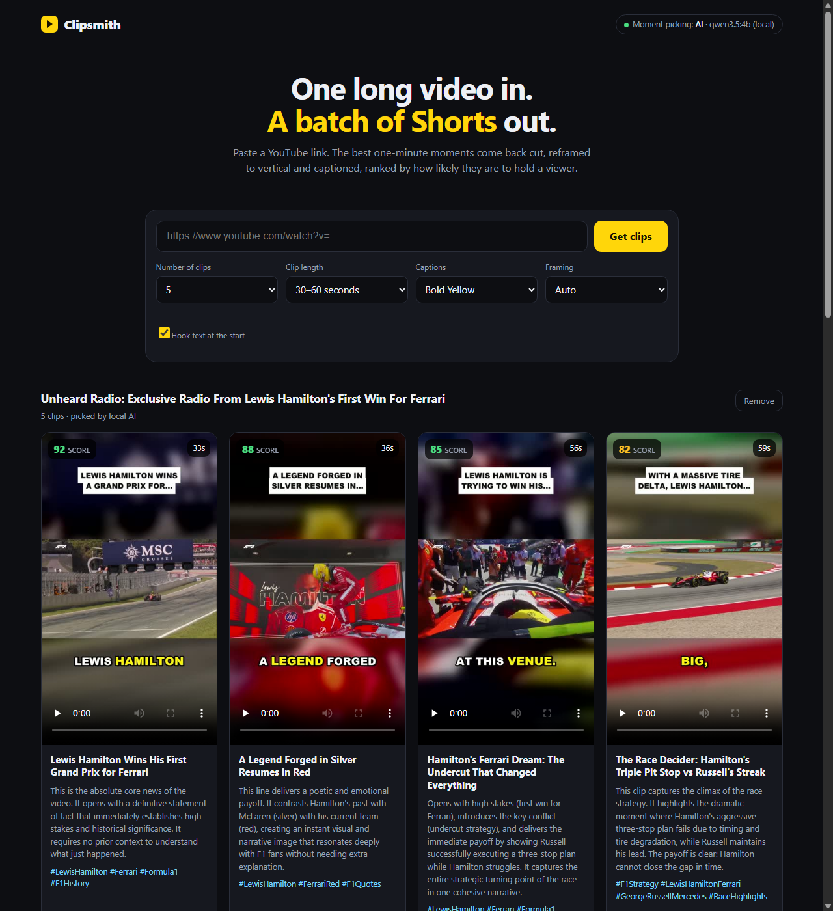

# Clipsmith

**A free, open-source alternative to OpusClip. Turn one long YouTube video into a batch of ready-to-post Shorts, on your own laptop.**

Paste a YouTube link. Clipsmith finds the best 30–60 second moments, crops them to vertical 9:16 around the speaker, burns in animated word-by-word captions, and ranks them by how likely they are to hold a viewer.

- **Free and unlimited.** No credits, no monthly plan, no watermark, no clips that expire after 3 days.
- **Runs offline.** Moment picking uses a local AI model (Qwen via Ollama). No API key, no account, your videos never leave your computer.
- **Works on an ordinary laptop.** No GPU needed; it was built and tested on a 4-core Intel laptop CPU.

> Not affiliated with OpusClip. "OpusClip" is mentioned only to describe what this project is an alternative to.



## What it does

1. **Downloads** the video and YouTube's captions (or transcribes the audio with Whisper if there are none).
2. **Picks the moments** that open strong, stand on their own and end on a complete thought, and gives each a viral score, a title, an on-screen hook, a caption and hashtags.
3. **Reframes** to 9:16, following the speaker's face. Wide shots get the full frame over a blurred background instead.
4. **Captions** every word as it's spoken, in one of three styles.
5. **Exports** MP4s you can download and upload to YouTube Shorts, TikTok or Reels.

## Install

You need **Python 3.10+**, **ffmpeg** and, for AI moment picking, **Ollama**.

### 1. Prerequisites

| | Windows | macOS | Linux |
|---|---|---|---|
| Python | [python.org](https://www.python.org/downloads/) | `brew install python` | your package manager |
| ffmpeg | `winget install Gyan.FFmpeg` | `brew install ffmpeg` | `sudo apt install ffmpeg` |
| Ollama | [ollama.com/download](https://ollama.com/download) | [ollama.com/download](https://ollama.com/download) | `curl -fsSL https://ollama.com/install.sh \| sh` |
| Deno *(YouTube downloads need a JS runtime)* | `winget install DenoLand.Deno` | `brew install deno` | `curl -fsSL https://deno.land/install.sh \| sh` |

Node.js works instead of Deno if you already have it.

### 2. Download the AI model (about 3.3 GB, once)

```
ollama pull qwen3.5:4b
```

### 3. Set up Clipsmith

```
git clone https://github.com/AbdulSamad94/clipsmith.git
cd clipsmith
```

- **Windows:** double-click `setup.bat`
- **macOS / Linux:** `./setup.sh`

## Run

- **Windows:** double-click `run.bat`
- **macOS / Linux:** `./run.sh`

Then open **http://127.0.0.1:8765**, paste a YouTube link and click **Get clips**.

## How long it takes

On a 4-core laptop CPU, a 12-minute video takes about **10 minutes**: a few minutes for the AI to read it, then about 1–3 minutes per clip to render. Longer videos take proportionally longer. Fewer clips means faster results.

## Choosing the AI

Set this in `.env` (copy it from `.env.example`):

| Option | Cost | Speed | Setting |
|---|---|---|---|
| **Local Qwen** (default) | Free | Slow on CPU | `AI_PROVIDER=ollama` |
| Google Gemini | Free tier | Fast | `AI_PROVIDER=gemini` + `GEMINI_API_KEY` |
| Anthropic Claude | Paid | Fast | `AI_PROVIDER=claude` + `ANTHROPIC_API_KEY` |
| None | Free | Fastest | `AI_PROVIDER=none` (basic scoring by rules) |

On a machine with more RAM or a GPU, try a bigger local model for better picks, e.g. `OLLAMA_MODEL=qwen3.5:9b`.

## Known limitations

- The small local model sometimes gets facts or numbers wrong in titles. **Check titles before posting.**
- Face tracking is basic (OpenCV). Fast camera cuts can make the crop lag.
- No direct posting to YouTube yet; you download the MP4 and upload it yourself.

## Roadmap

- [ ] Filler word and silence removal
- [ ] "Prompt to clip": describe the moment you want
- [ ] Edit clip start/end and caption text before export
- [ ] Keyword and emoji highlights in captions
- [ ] Brand template (logo, fonts, colours)
- [ ] Post and schedule directly to YouTube

Contributions are welcome. Open an issue first for anything large.

## Use responsibly

Only clip videos you own or have permission to reuse. Downloading from YouTube may break YouTube's Terms of Service, and re-uploading other people's content can get your channel struck. You are responsible for how you use this tool.

## License

[MIT](LICENSE)
